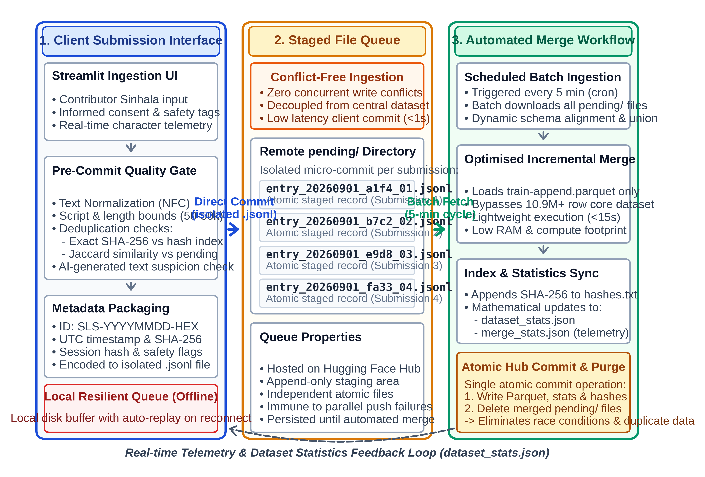
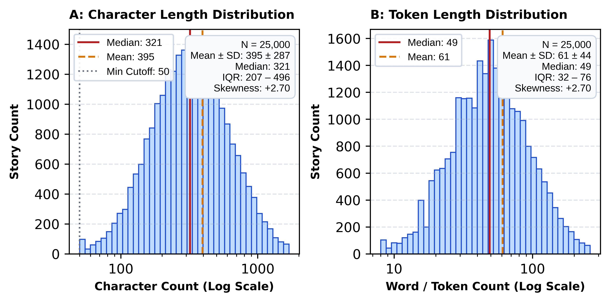

# Summary

Progress in modern natural language processing (NLP) is disproportionately concentrated in high-resource languages due to the abundance of digitized web-scale text. Low-resource languages, such as Sinhala (an Indo-Aryan language spoken by over 17 million people), suffer from severe data sparsity, fragmented digital corpora, and lack of standardized crowdsourcing infrastructure [@joshi2020state; @ranathunga2023sinhala]. 

`Sinhala-Stories-Dataset-Creator` is an open-source, fault-tolerant crowdsourcing and incremental dataset ingestion framework engineered for low-resource NLP. The framework decouples high-concurrency contributor submissions from large-scale corpus storage on the Hugging Face Hub, bypassing Git tree write contention and eliminating out-of-memory overhead during data ingestion. Although its flagship deployment curates the 10.9-million-row `Isuru0x01/sinhala_stories` corpus, the framework is architecturally generalized: by modifying a single declarative configuration file (`config.yaml`), researchers and language communities can immediately deploy identical fault-tolerant ingestion pipelines for other low-resource scripts (e.g., Tamil, Dhivehi, Khmer, or Swahili).

# Statement of Need

Collecting web-scale or domain-specific text for low-resource languages typically relies on participatory crowdsourcing [@nekoto2020participatory]. However, deploying real-time crowdsourcing applications directly against version-controlled cloud repositories like the Hugging Face Hub [@wolf2020transformers; @lhoest2021datasets] presents severe engineering bottlenecks:

1. **Concurrent Write Collisions:** Traditional Git-backed storage repositories fail when multiple distributed contributors attempt to commit records simultaneously, resulting in merge conflicts and dropped submissions.
2. **Memory and Bandwidth Scalability:** Directly appending records to massive multi-gigabyte monolithic Apache Parquet [@pyarrow2024] files in an active web app exhausts server memory and introduces unacceptable latency for end users.
3. **Quality and Noise Gating:** Low-resource web submissions often suffer from mixed-script contamination, synthetic text spam, and near-duplicate submissions. Running exhaustive pairwise duplicate comparisons across millions of records during web ingestion is computationally prohibitive ($O(N)$ or $O(N^2)$).
4. **Offline and Network Volatility:** In regions with intermittent internet connectivity, contributors frequently lose long-form submissions due to transient connection drops.

`Sinhala-Stories-Dataset-Creator` resolves these challenges through a three-stage decoupled architecture featuring asynchronous staged micro-queues, automated two-tier deduplication, offline browser-side queueing, and scheduled incremental Parquet ingestion.

# State of the Field

Existing pipelines for low-resource language dataset acquisition generally fall into three categories, none of which address concurrent community crowdsourcing with automated cloud repository synchronization:

1. **Web-Scraped Corpus Extractors:** Pipelines scraping Common Crawl or multilingual web dumps (e.g., CC100, OSCAR, MADLAD-400) suffer from catastrophic quality degradation in low-resource scripts, including machine-translated gibberish, heavy boilerplate contamination, and encoding corruption [@joshi2020state; @kreutzer2022quality].
2. **Generic Survey and Form Tools:** Form builders (e.g., Google Forms, Qualtrics, KoboToolbox) lack domain-specific validation, script ratio verification, cryptographic deduplication, and automated formatting into machine-learning-ready schemas.
3. **Annotation Platforms:** Tools such as Label Studio, Prodigy, or doccano focus primarily on human-in-the-loop classification and entity tagging for pre-existing texts, rather than large-scale, participatory raw text authoring and ingestion.

### Build vs. Contribute Justification
Direct crowdsourcing interfaces hosted on Hugging Face Spaces typically attempt synchronous commits directly into the target dataset repository. Under active contributor traffic, this design suffers immediate Git lock contention, commit rejection, and severe memory exhaustion when re-serializing monolithic Parquet files. Rather than deploying and maintaining cost-prohibitive relational databases or distributed message queues (e.g., Kafka or RabbitMQ) that impose severe infrastructure costs on academic researchers, `Sinhala-Stories-Dataset-Creator` establishes a zero-cost serverless pattern. By combining Hugging Face Hub API primitives with GitHub Actions automation, it delivers conflict-free, cost-effective crowdsourcing accessible to under-resourced research groups.

# Software Design

The framework operates as a decoupled, three-tier ingestion and synchronization pipeline, illustrated in \autoref{fig:architecture}.

### Key Architectural Components

1. **Client Submission Interface (`app.py`):** Built on Streamlit, the contributor interface provides a responsive, low-latency environment for text input. The client executes real-time telemetry analytics (character counts, word counts, unique character counts, average word length, sentence/paragraph segmentation, and estimated reading time) and enforces contributor consent for open research release. If the remote Hugging Face API is unreachable due to network volatility, the client automatically diverts submissions to an encrypted local disk queue (`local_queue/`) and replays them upon connection restoration.
2. **Conflict-Free Staging Micro-Queue:** Rather than writing directly to the primary dataset file, each valid submission is serialized into an isolated micro-file (`pending/story_<timestamp>_<hash_prefix>.jsonl`) and committed via the Hugging Face Hub API. Because each submission targets a unique filename, hundreds of concurrent contributors can submit stories simultaneously without experiencing Git lock contention or merge collisions.
3. **Automated Incremental Merge Engine (`merge_pending_into_main.py`):** A scheduled GitHub Actions workflow (or daemon runner) executes periodically (e.g., every 5 minutes). The engine scans and downloads pending micro-files, harmonizes schema features, appends records directly to an auxiliary delta partition (`data/train-append.parquet`), updates SHA-256 fingerprints in `hashes.txt`, recalculates corpus statistics in `dataset_stats.json`, and deletes processed micro-files within a single atomic commit.

### Engineering Design Trade-offs

* **Staged Micro-Queuing vs. Centralized Relational Database:** Choosing remote micro-file staging over an external database (e.g., PostgreSQL) eliminates hosting expenses and authentication overhead. The minor trade-off is eventual consistency, as submissions reside in `pending/` until the next scheduled batch merge.
* **Delta Parquet Partitioning vs. Monolithic File Appending:** Appending records to an auxiliary delta partition (`train-append.parquet`) allows the merge engine to run within standard memory constraints (sub-500 MB RAM), completely bypassing the prohibitive network transfer and memory overhead of rewriting the 10.9M-row base corpus.
* **Two-Tier Deduplication vs. Exhaustive Pairwise Comparisons:** Running pairwise n-gram or string distance comparisons against millions of records is computationally intractable ($O(N)$) during real-time web requests. The framework trades full pairwise fuzzy matching across the historical archive for instant $O(1)$ SHA-256 cryptographic hash lookup via an optimized binary Bloom Filter and hash catalog, reserving fuzzy lexical Jaccard matching ($J(A, B) \ge 0.85$) strictly for the transient pending staging queue.

# Quality Control and Validation Pipeline

The pure Python module `validator.py` decouples validation logic from the presentation layer to ensure modularity, high performance, and unit-testability.

### Unicode Normalization and Cleaning
All input text is normalized to Unicode Normalization Form C (NFC) via `unicodedata.normalize()`, eliminating non-standard composable diacritic inconsistencies common in Indic and Brahmic scripts. Redundant punctuation (e.g., repeated dots `...`) is collapsed to single stops, and whitespace sequences are standardized.

### Script Ratio and Language Verification
To prevent cross-language script contamination, the module calculates the ratio of alphabetic characters within the target Unicode block:
$$\text{Ratio}_{\text{script}} = \frac{\sum_{c \in S_{\text{alpha}}} \mathbb{I}(U_{\text{start}} \le \text{ord}(c) \le U_{\text{end}})}{|S_{\text{alpha}}|}$$
Submissions falling below the configured threshold ($\text{Ratio}_{\text{script}} < 0.90$) are rejected. Subsequently, `langid` [@lui2012langid] computes language identification probabilities using a normalized softmax over candidate log-likelihoods, ensuring high-confidence classification ($P(\text{target}) \ge 0.90$).

### Heuristic Spam and Synthetic Text Gating
A composite heuristic quality score penalizes abnormal repetition patterns and synthetic gibberish:
* Consecutive character repetitions of length $\ge 5$;
* Repetitive consecutive n-grams and high bigram repetition ratios ($>40\%$);
* High sentence-level duplication ratios;
* Abnormal vocabulary diversity ($\frac{|V_{\text{unique}}|}{|V_{\text{total}}|} < 0.40$);
* Shannon character entropy gating ($H(X) = -\sum P(c)\log_2 P(c) < 2.5\text{ bits/char}$), penalizing keyboard-mashing, bot loops, and low-diversity generation.
Submissions with a quality score below 0.20 are flagged and prevented from entering the ingestion queue.

# Research Impact Statement

The primary deployment of this framework maintains the `Isuru0x01/sinhala_stories` corpus on the Hugging Face Hub, encompassing over 10.9 million rows (1.23+ billion characters, across 4.5+ GB of uncompressed text) of validated Sinhala literature, folklore, and contemporary writing [@samarappulige2026zenodo]. \autoref{fig:distribution} shows the character length distribution of the dataset, highlighting broad coverage ranging from concise vignettes to extensive narrative chapters.

The corpus has been archived on Zenodo with persistent identifier `10.5281/zenodo.21195380`. Crucially, the dataset curated by this software directly powers downstream research in low-resource representation learning. Specifically, the corpus is utilized in experimental tokenizer research exploring akshara-preserving subword tokenizers for Sinhala large language models, evaluating token fertility, Akshara Integrity Rate (AIR), and byte-fallback frequencies against state-of-the-art multilingual baselines (e.g., LLaMA-3, Qwen-2.5, Gemma-2, and XLM-RoBERTa). Furthermore, the declarative design of `config.yaml` enables immediate adoption by research teams working on other low-resource Brahmic and African language varieties.

# AI Usage Disclosure

Generative artificial intelligence tools (specifically Anthropic Claude and Google Gemini) were utilized during project development for drafting boilerplate unit test cases, refactoring modular components, and reviewing stylistic clarity in documentation. All core algorithmic designs, validation logic, system architecture, dataset curation workflows, and manuscript prose were conceived, implemented, empirically tested, and verified by the authors.

# Acknowledgements

We express our gratitude to the contributors of the open-source libraries utilized in this project, including Streamlit, Hugging Face Hub, Datasets, PyArrow, NumPy [@vanderwalt2011numpy], and langid.py. We also thank the native-speaking contributors who contributed stories to the Sinhala open-access dataset.

# References
